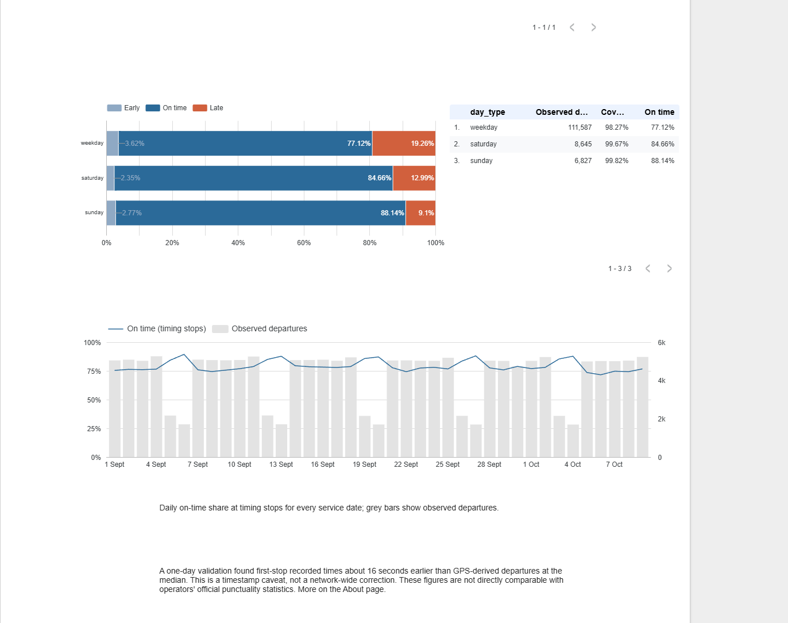

# How punctual is public transport in Kronoberg?

**A data analysis project using real timetable and realtime records**

[Svenska](portfolio-sv.md) · [Code and data](#explore-the-project)

I built this project to explore punctuality in Kronoberg: how it varies across
the week, which times of day stand out, and how much confidence I could place
in the underlying data. The result is a daily data pipeline and a dashboard
covering the network, routes, stations and data quality.

For September 2026, **78.23% of observed departures at timing stops were on
time**. The data covered **98.44% of eligible departures**. That second figure
matters: without it, a punctuality result can look convincing even when a
substantial part of the schedule is missing.

## From transit feeds to a usable dashboard

I used Trafiklab's KoDa archive to obtain historical realtime records and the
timetable for each service date. Python handles fetching and parsing;
DuckDB SQL matches the records, calculates delays and produces the reporting
tables. The cleaned data is stored as Parquet on Hugging Face, with aggregates
sent to Google Sheets for the Data Studio dashboard.

The dashboard has six pages: Overview, When, Routes, Stations, Data quality
and About. A reader can explore the patterns, see the sample sizes and
coverage, and check how the measures are defined. The station map uses bubble
size for observed departures and colour for punctuality.

*Dashboard screenshot. The daily chart includes early October; the figures in
this case study use September's 30 complete service dates only.*

## What September showed

The main analysis uses timing stops, where the timetable specifies a fixed
time, and excludes a trip's final stop. I defined an on-time departure as
between one minute early and three minutes late, including both boundaries.

| September 2026 | Result |
|---|---:|
| Observed timing-stop departures | 127,059 |
| On-time departures | 99,396 |
| Punctuality | 78.23% |
| Coverage | 98.44% |

Weekday punctuality was **77.12%**, compared with **84.66% on Saturdays** and
**88.14% on Sundays**. The weakest reportable weekday hour was **16:00–16:59**,
at **62.62%**, based on 10,514 observed departures. That makes the afternoon
a useful starting point for a closer look at route and direction patterns.
Explaining the difference would require more evidence about the services and
conditions in each group.

The station view adds another way to explore the data. Stortorget, for example,
had **21,598 observed departures**, **99.82% coverage** and **84.05% punctuality**.
Overall, 256 station groups met the reporting requirements for the September
timing-stop view.

## The hardest part was deciding what counted as an observation

My initial working assumption was that a stop disappearing from the realtime
feed could help identify when the vehicle had passed it. Full-day checks showed
that passed stops could remain in the feed for about ten minutes. I had to
revisit that assumption before building the delay calculations.

The final rule uses the feed's recorded-time marker on the last retained value.
Final stops are excluded because a trip can disappear before its final stop
receives that marker. I also kept trips with missing realtime data separate
from cancellations: September contained **290 of the former and 39 of the
latter**.

Reporting rules made a visible difference to the analysis. School-route
coverage was only **83.39%**, so I withheld that category's punctuality result.
It fell below the project's 90% coverage requirement. Every reported
punctuality figure also needs at least 20 distinct observed trips.

## What I learned

The most useful part of this project was learning how much work sits behind
a percentage on a dashboard. Choosing the denominator, investigating feed
behaviour and showing missing observations shaped the result as much as the
visual design did.

I also checked how the chosen threshold affected the headline. Keeping the
same one-minute early limit, punctuality was **55.23%** with a one-minute late
limit and **88.58%** with a five-minute late limit. Readers can see that
sensitivity rather than having to accept a single cut-off without context.

There are limits to the measurement. A one-day GPS comparison found recorded
times at first stops about **16 seconds earlier at the median** than GPS-derived
departures. I kept that finding as a caveat; I did not apply a network-wide
correction. The results also use their own thresholds and stop selection, so
they cannot be compared directly with the operator's official statistics.

For the September write-up, I pinned the dataset version, rebuilt all 30 dates
and checked the headline counts separately against the stop-event records.
All 229 aggregation checks and 158 existing tests passed. Someone reviewing
the project can follow the same definitions and reproduce the figures.

## Explore the project

- [Repository](https://github.com/Iskarioth/kronoberg-transit)
- [September dataset version](https://huggingface.co/datasets/Traumenteize/kronoberg-transit-punctuality/tree/3cb190163d9c400fd915bd62a919f8f9bfc90dd7)
- [Detailed case study, calculations and reproduction steps](case-study.md)
- [Metric definitions](definitions.md) and [decision log](decisions.md)

The dashboard is currently restricted. The screenshot, code, data and
documentation provide a way to review the work without access to the live
report. This is an independent portfolio project, with no affiliation to
Länstrafiken Kronoberg or Trafiklab.
