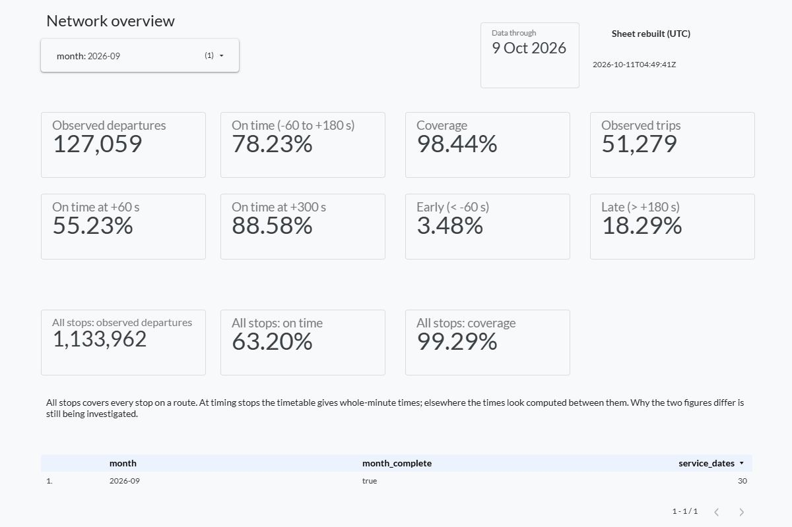
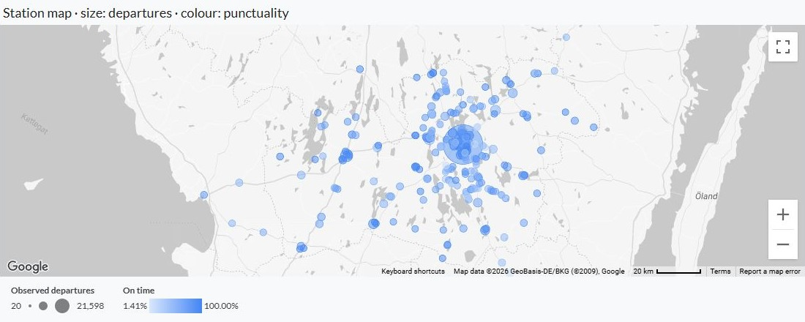

# Hur punktlig är kollektivtrafiken i Kronoberg?

**Ett analysprojekt med verkliga tidtabeller och realtidsdata**

[English](portfolio-en.md) · [Kod och data](#utforska-projektet)

Jag byggde det här projektet för att undersöka punktligheten i Kronoberg:
hur den varierar under veckan, vilka tider på dygnet som sticker ut och
hur mycket jag kunde lita på underlaget. Resultatet blev ett dagligt dataflöde
och en dashboard med vyer för hela nätet, linjer, hållplatser och datakvalitet.

I september 2026 var **78,23 % av de observerade avgångarna i tid** vid
hållplatser med fast tid i tidtabellen. Datatäckningen var **98,44 %** av de
avgångar som ingår i mätningen. Täckningen är viktig för tolkningen: en
punktlighetssiffra kan se övertygande ut även om en stor del av tidtabellen
saknar observationer.

## Från trafikdata till en användbar dashboard

Jag använde Trafiklabs KoDa-arkiv för att hämta historiska realtidsuppgifter
och tidtabellen för varje trafikdag. Python sköter hämtning och inläsning;
DuckDB SQL matchar uppgifterna, beräknar förseningar och tar fram de tabeller
som används i rapporten. Bearbetade data lagras som Parquet på Hugging Face.
Sammanställningar skickas till Google Sheets och visas i Data Studio.

Dashboarden har sex sidor: Overview, When, Routes, Stations, Data quality
och About. Där går det att undersöka mönster, se antalet observationer och
datatäckningen samt läsa hur måtten är definierade. På hållplatskartan visar
bubblornas storlek antalet observerade avgångar och färgen punktligheten.

*Den uppdaterade översikten, fångad den 11 oktober 2026. September är vald
månad. Uppdateringsinformationen visar hur färska de bakomliggande uppgifterna är.*

## Vad september visade

Huvudanalysen gäller hållplatser med fast tid i tidtabellen och utesluter
turernas sluthållplatser. Jag räknade en avgång som punktlig om den skedde
från en minut före till tre minuter efter tidtabellstiden, inklusive gränserna.

| September 2026 | Resultat |
|---|---:|
| Observerade avgångar vid hållplatser med fast tid | 127 059 |
| Avgångar i tid | 99 396 |
| Punktlighet | 78,23 % |
| Datatäckning | 98,44 % |

På vardagar var punktligheten **77,12 %**, jämfört med **84,66 % på lördagar**
och **88,14 % på söndagar**. Den vardagstimme som hade lägst punktlighet och
samtidigt uppfyllde rapporteringskraven var **16.00–16.59**: **62,62 %**,
baserat på 10 514 observerade avgångar. Eftermiddagen är därför en rimlig
utgångspunkt för att titta närmare på vilka linjer och riktningar som ingår.
För att förklara skillnaden behövs mer underlag om trafiken och förhållandena
i respektive grupp.

Hållplatsvyn ger ett annat sätt att utforska materialet. Stortorget hade
till exempel **21 598 observerade avgångar**, **99,82 % datatäckning** och
**84,05 % punktlighet**. Totalt uppfyllde 256 hållplatsgrupper kraven för
septembervyn med fasta tidtabellstider.

*Septembers hållplatser med fast tid i tidtabellen som uppfyller
rapporteringskraven, över alla dagar. Större bubblor betyder fler observerade
avgångar, och färgskalan visar punktligheten.*

## Det svåraste var att avgöra vad som räknades som en observation

Mitt första arbetsantagande var att en hållplats som försvann ur
realtidsflödet kunde hjälpa mig att avgöra när fordonet hade passerat den.
Kontroller av hela trafikdagar visade att passerade hållplatser kunde ligga
kvar i flödet i ungefär tio minuter. Jag behövde ompröva antagandet innan
jag byggde beräkningarna av förseningar.

Den slutliga regeln använder flödets markering för registrerad tid på det
sista kvarvarande värdet. Sluthållplatser utesluts eftersom en tur kan
försvinna innan dess sista hållplats får markeringen. Jag höll också turer
utan realtidsdata åtskilda från inställda turer: i september fanns **290 turer
utan realtidsdata och 39 inställda turer**.

Rapporteringskraven påverkade vilka resultat som gick att visa. Skollinjerna
hade bara **83,39 % datatäckning**, så jag utelämnade deras punktlighetsresultat.
Täckningen låg under projektets krav på 90 %. Varje punktlighetsresultat måste
dessutom bygga på minst 20 olika observerade turer.

## Vad jag tar med mig

Det mest lärorika var att se hur mycket arbete som ligger bakom en procentsats
i en dashboard. Valet av nämnare, undersökningen av realtidsflödet och
hanteringen av saknade observationer påverkade resultatet lika mycket som
den visuella utformningen.

Jag undersökte också hur gränsen för försening påverkade punktligheten.
Med samma gräns på en minut för tidig avgång blev resultatet **55,23 %**
när högst en minuts försening tilläts, och **88,58 %** med högst fem minuter.
Det ger läsaren möjlighet att se hur känsligt resultatet är för den valda
gränsen.

Mätningen har begränsningar. En GPS-jämförelse under en trafikdag visade att
registrerade tider vid turernas första hållplatser låg ungefär **16 sekunder
tidigare i median** än de GPS-baserade avgångstiderna. Jag behöll det som en
reservation i tolkningen och gjorde ingen generell korrigering av nätets
resultat. Måtten har också egna tidsgränser och ett eget urval av hållplatser,
så de går inte att jämföra direkt med trafikoperatörens officiella statistik.

För septemberanalysen låste jag datamängden till en bestämd version,
byggde om sammanställningarna för alla 30 dagar och kontrollerade
huvudresultatets antal separat mot hållplatsobservationerna. Alla 229
kontroller av sammanställningarna och 158 befintliga tester klarades.
Det går därmed att följa definitionerna och återskapa siffrorna.

## Utforska projektet

- [Kod på GitHub](https://github.com/Iskarioth/kronoberg-transit)
- [Dataversionen för september](https://huggingface.co/datasets/Traumenteize/kronoberg-transit-punctuality/tree/3cb190163d9c400fd915bd62a919f8f9bfc90dd7)
- [Detaljerad analys, beräkningar och instruktioner för att återskapa resultaten, på engelska](case-study.md)
- [Måttdefinitioner](definitions.md) och [beslutslogg](decisions.md), på engelska

Dashboarden har tills vidare begränsad åtkomst. Skärmbilden, koden,
datamängden och dokumentationen gör det möjligt att granska arbetet utan
tillgång till den liveversionen. Det här är ett fristående portfolioprojekt
utan koppling till Länstrafiken Kronoberg eller Trafiklab som uppdragsgivare.
